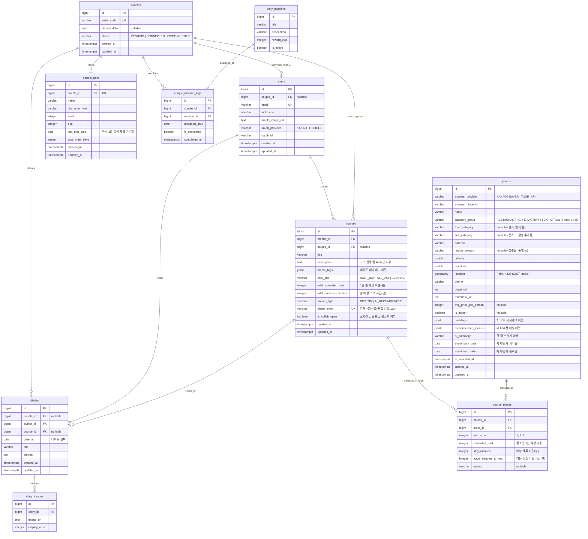

# DayT 데이터베이스 설계서 (ERD)

> **기준 DBMS**: PostgreSQL 16+ (`PostGIS` 공간 확장 활성화)  
> **연동 문서**: [docs/prd.md](./prd.md)의 P0 ~ P2 전체 도메인(`인증`, `커플`, `장소·AI 요약`, `코스`, `Grow Together`, `일기장`)을 포괄하도록 설계한다.

---

## 1. 핵심 설계 원칙

1. **공간 연산 최적화 (`PostGIS`)**: `places` 테이블에 위·경도 숫자 컬럼(`latitude`, `longitude`)과 함께 `GEOGRAPHY(Point, 4326)` 컬럼 및 `GIST` 공간 인덱스를 두어 *"특정 역/동네 반경 1.5km 내 후보 장소 필터링"*을 고속 처리한다.
2. **반정형 AI 데이터 저장 (`JSONB`)**: Gemini가 추출한 해시태그 배열(`hashtags`), 추천 메뉴(`recommended_menus`), 코스 테마 태그(`theme_tags`)는 별도 조인 테이블 남발 대신 PostgreSQL `JSONB` + `GIN` 인덱스로 유연하고 빠르게 조회한다.
3. **솔로 / 커플 모드 유연 지원**: `users.couple_id`를 `NULL` 허용으로 설계하여, 아직 연인과 계정을 연결하지 않은 단일 사용자도 장소 탐색 및 코스 제작(P0~P1)을 제약 없이 이용할 수 있게 한다.
4. **코스 내 장소 순서 및 동선 보존**: `course_places` 매핑 테이블에 방문 순서(`visit_order`), 장소별 1인 예상 지출(`estimated_cost`), 체류 시간(`stay_minutes`), 다음 장소 이동 시간(`travel_minutes_to_next`)을 명시한다.

---

## 2. 전체 ERD 다이어그램 (Mermaid)

---

## 3. 테이블별 상세 명세

### 3.1 회원 및 커플 도메인 (`users`, `couples`)

#### `users` (사용자)
| 컬럼명 | 타입 | 제약조건 | 설명 |
| :--- | :--- | :--- | :--- |
| `id` | `BIGSERIAL` | `PK` | 사용자 고유 식별자 |
| `couple_id` | `BIGINT` | `FK (couples.id)`, `NULL` | 연결된 커플 ID (미연결 시 `NULL`) |
| `email` | `VARCHAR(255)` | `UNIQUE`, `NULL` | 이메일 (소셜 제공 여부에 따라 선택) |
| `nickname` | `VARCHAR(50)` | `NOT NULL` | 서비스 표시 닉네임 |
| `profile_image_url` | `TEXT` | `NULL` | 프로필 이미지 URL |
| `oauth_provider` | `VARCHAR(20)` | `NOT NULL` | `'KAKAO'` \| `'GOOGLE'` |
| `oauth_id` | `VARCHAR(100)` | `NOT NULL` | OAuth 제공자 측 고유 사용자 ID |
| `created_at` | `TIMESTAMPTZ` | `NOT NULL`, `DEFAULT NOW()` | 가입 일시 |
| `updated_at` | `TIMESTAMPTZ` | `NOT NULL`, `DEFAULT NOW()` | 수정 일시 |

- **Unique 제약**: `UNIQUE (oauth_provider, oauth_id)`

#### `couples` (커플 매칭)
| 컬럼명 | 타입 | 제약조건 | 설명 |
| :--- | :--- | :--- | :--- |
| `id` | `BIGSERIAL` | `PK` | 커플 고유 식별자 |
| `invite_code` | `VARCHAR(20)` | `UNIQUE`, `NOT NULL` | 상대방 연결용 초대 코드 |
| `started_date` | `DATE` | `NULL` | 연애 시작일 (D-Day 표시용) |
| `status` | `VARCHAR(20)` | `NOT NULL`, `DEFAULT 'PENDING'` | `'PENDING'` \| `'CONNECTED'` \| `'DISCONNECTED'` |
| `created_at` | `TIMESTAMPTZ` | `NOT NULL`, `DEFAULT NOW()` | 생성 일시 |
| `updated_at` | `TIMESTAMPTZ` | `NOT NULL`, `DEFAULT NOW()` | 수정 일시 |

---

### 3.2 장소 및 AI 데이터 도메인 (`places`)

#### `places` (장소 마스터 + Gemini 요약 데이터)
| 컬럼명 | 타입 | 제약조건 | 설명 |
| :--- | :--- | :--- | :--- |
| `id` | `BIGSERIAL` | `PK` | 장소 고유 식별자 |
| `external_provider` | `VARCHAR(20)` | `NOT NULL` | 데이터 원천 (`'KAKAO'` \| `'NAVER'` \| `'TOUR_API'`) |
| `external_place_id` | `VARCHAR(100)` | `NOT NULL` | 원천 API의 장소 고유 ID |
| `name` | `VARCHAR(150)` | `NOT NULL` | 장소명 |
| `category_group` | `VARCHAR(30)` | `NOT NULL` | `'RESTAURANT'` \| `'CAFE'` \| `'ACTIVITY'` \| `'EXHIBITION'` \| `'PARK'` \| `'ETC'` |
| `food_category` | `VARCHAR(30)` | `NULL` | 음식 대분류 (`'한식'`, `'중식'`, `'일식'`, `'양식'`, `'치킨'`, `'고기'`, `'분식'`, `'기타'`) |
| `sub_category` | `VARCHAR(100)` | `NULL` | 세부 업종/메뉴 키워드 (예: `'텐동'`, `'파스타'`, `'보드게임카페'`) |
| `address` | `VARCHAR(255)` | `NOT NULL` | 도로명 또는 지번 주소 |
| `region_keyword` | `VARCHAR(50)` | `NULL` | 대표 상권 키워드 (예: `'성수동'`, `'홍대'`) |
| `latitude` | `DOUBLE PRECISION` | `NOT NULL` | 위도 (`WGS84`) |
| `longitude` | `DOUBLE PRECISION` | `NOT NULL` | 경도 (`WGS84`) |
| `location` | `GEOGRAPHY(Point, 4326)` | `NOT NULL` | PostGIS 공간 좌표 (`ST_DWithin` 반경 검색용) |
| `phone` | `VARCHAR(30)` | `NULL` | 전화번호 |
| `place_url` | `TEXT` | `NULL` | 원천 플레이스 상세 URL |
| `thumbnail_url` | `TEXT` | `NULL` | 대표 이미지 URL |
| `avg_price_per_person` | `INTEGER` | `NULL` | 1인 예상 평균 비용(원) |
| `is_indoor` | `BOOLEAN` | `NULL` | 실내 장소 여부 (`true`: 비/눈 오는 날 추천 우대) |
| `hashtags` | `JSONB` | `NOT NULL`, `DEFAULT '[]'` | AI 추출 해시태그 배열 (예: `["#주차가_편해요", "#디저트_맛집"]`) |
| `recommended_menus` | `JSONB` | `NOT NULL`, `DEFAULT '[]'` | 대표/추천 메뉴 배열 |
| `ai_summary` | `VARCHAR(300)` | `NULL` | AI 한 줄 무드 요약 |
| `event_start_date` | `DATE` | `NULL` | 전시·축제 시작일 (상시 매장은 `NULL`) |
| `event_end_date` | `DATE` | `NULL` | 전시·축제 종료일 (상시 매장은 `NULL`) |
| `ai_enriched_at` | `TIMESTAMPTZ` | `NULL` | Gemini 요약 파이프라인 최종 실행 일시 |
| `created_at` | `TIMESTAMPTZ` | `NOT NULL`, `DEFAULT NOW()` | 등록 일시 |
| `updated_at` | `TIMESTAMPTZ` | `NOT NULL`, `DEFAULT NOW()` | 수정 일시 |

- **주요 인덱스**:
  - `UNIQUE (external_provider, external_place_id)` — 중복 수집 방지(Upsert 기준)
  - `CREATE INDEX idx_places_location ON places USING GIST (location);` — 반경 탐색 최적화
  - `CREATE INDEX idx_places_hashtags ON places USING GIN (hashtags);` — 해시태그 포함 검색 최적화
  - `CREATE INDEX idx_places_category ON places (category_group, food_category);`

---

### 3.3 데이트 코스 도메인 (`courses`, `course_places`)

#### `courses` (데이트 코스 헤더)
| 컬럼명 | 타입 | 제약조건 | 설명 |
| :--- | :--- | :--- | :--- |
| `id` | `BIGSERIAL` | `PK` | 코스 고유 식별자 |
| `creator_id` | `BIGINT` | `FK (users.id)`, `NOT NULL` | 최초 작성자 ID |
| `couple_id` | `BIGINT` | `FK (couples.id)`, `NULL` | 공유된 커플 ID |
| `title` | `VARCHAR(100)` | `NOT NULL` | 코스 제목 |
| `description` | `TEXT` | `NULL` | 코스 설명 또는 AI 추천 코멘트 |
| `theme_tags` | `JSONB` | `NOT NULL`, `DEFAULT '[]'` | 선택한 테마 태그 배열 (`["감성 카페", "맛집 투어"]`) |
| `time_slot` | `VARCHAR(20)` | `NULL` | `'HALF_DAY'` \| `'ALL_DAY'` \| `'EVENING'` |
| `total_estimated_cost` | `INTEGER` | `NOT NULL`, `DEFAULT 0` | 코스 합산 1인 예상 비용(원) |
| `total_duration_minutes` | `INTEGER` | `NOT NULL`, `DEFAULT 0` | 체류 + 이동 합산 총 소요 시간(분) |
| `source_type` | `VARCHAR(20)` | `NOT NULL`, `DEFAULT 'CUSTOM'` | `'CUSTOM'` (직접 제작) \| `'AI_RECOMMENDED'` (AI 생성) |
| `share_token` | `VARCHAR(64)` | `UNIQUE`, `NOT NULL` | 외부 공유(OG) 및 공동 편집 접속용 난수 토큰 |
| `is_collab_open` | `BOOLEAN` | `NOT NULL`, `DEFAULT FALSE` | 실시간 공동 코스 편집 허용 상태 |
| `created_at` | `TIMESTAMPTZ` | `NOT NULL`, `DEFAULT NOW()` | 생성 일시 |
| `updated_at` | `TIMESTAMPTZ` | `NOT NULL`, `DEFAULT NOW()` | 수정 일시 |

#### `course_places` (코스-장소 매핑 및 방문 순서 — 기획 초안 `Course_Place_Mapping`)
| 컬럼명 | 타입 | 제약조건 | 설명 |
| :--- | :--- | :--- | :--- |
| `id` | `BIGSERIAL` | `PK` | 매핑 고유 식별자 |
| `course_id` | `BIGINT` | `FK (courses.id) CASCADE`, `NOT NULL` | 소속 코스 ID |
| `place_id` | `BIGINT` | `FK (places.id)`, `NOT NULL` | 방문 장소 ID |
| `visit_order` | `INTEGER` | `NOT NULL` | 코스 내 방문 순서 (`1, 2, 3...`) |
| `estimated_cost` | `INTEGER` | `NOT NULL`, `DEFAULT 0` | 해당 장소에서의 1인 예상 소비 비용(원) |
| `stay_minutes` | `INTEGER` | `NOT NULL`, `DEFAULT 60` | 예상 체류 시간(분) |
| `travel_minutes_to_next` | `INTEGER` | `NOT NULL`, `DEFAULT 0` | 다음 순서 장소까지 예상 이동 시간(분) |
| `memo` | `VARCHAR(255)` | `NULL` | 사용자 한 줄 메모 (예: `"창가 자리 예약하기"`) |

- **주요 인덱스**: `CREATE INDEX idx_course_places_order ON course_places (course_id, visit_order);`

---

### 3.4 커플 리텐션 및 일기장 도메인 (`couple_pets`, `daily_missions`, `couple_mission_logs`, `diaries`, `diary_images`) — *P2 확장*

#### `couple_pets` (Grow Together 캐릭터)
| 컬럼명 | 타입 | 제약조건 | 설명 |
| :--- | :--- | :--- | :--- |
| `id` | `BIGSERIAL` | `PK` | 펫 고유 식별자 |
| `couple_id` | `BIGINT` | `UNIQUE`, `FK (couples.id) CASCADE` | 커플당 1마리 공유 펫 |
| `name` | `VARCHAR(50)` | `NOT NULL` | 펫 애칭 |
| `character_type` | `VARCHAR(30)` | `NOT NULL`, `DEFAULT 'BASIC'` | 캐릭터 종/진화 타입 |
| `level` | `INTEGER` | `NOT NULL`, `DEFAULT 1` | 현재 성장 레벨 |
| `exp` | `INTEGER` | `NOT NULL`, `DEFAULT 0` | 현재 누적 경험치 |
| `last_met_date` | `DATE` | `NULL` | 마지막 만남 성장 반영 날짜 (하루 단위 1회 제한 기준) |
| `total_meet_days` | `INTEGER` | `NOT NULL`, `DEFAULT 0` | 누적 데이트 인증 일수 |
| `created_at` | `TIMESTAMPTZ` | `NOT NULL`, `DEFAULT NOW()` | 생성 일시 |
| `updated_at` | `TIMESTAMPTZ` | `NOT NULL`, `DEFAULT NOW()` | 수정 일시 |

#### `daily_missions` & `couple_mission_logs` (오늘의 성장 미션)
- **`daily_missions`**: 미션 마스터 풀 (`id`, `title`, `description`, `reward_exp`, `is_active`)
- **`couple_mission_logs`**: 커플별 일일 배정 및 달성 기록 (`id`, `couple_id`, `mission_id`, `assigned_date`, `is_completed`, `completed_at`) — `UNIQUE (couple_id, mission_id, assigned_date)`

#### `diaries` & `diary_images` (데이트 일기장)
- **`diaries`**: 데이트 일기 본문 (`id`, `couple_id`, `author_id`, `course_id[NULL 허용 - 실제 다녀온 코스 연결]`, `date_at`, `title`, `content`, `created_at`, `updated_at`)
- **`diary_images`**: 일기 첨부 사진 (`id`, `diary_id`, `image_url`, `display_order`)

---

## 4. Redis 캐시 키 설계 (보조 저장소)

| 용도 | Key 패턴 예시 | TTL | 저장 형태 |
| :--- | :--- | :---: | :--- |
| 지역·카테고리 장소 검색 캐시 | `places:search:{region}:{category}:{food}` | `6시간` | JSON Array |
| AI 맞춤 코스 추천 결과 캐시 | `ai:recommend:{hash(조건파라미터)}` | `1시간` | JSON Object |
| 실시간 공동 코스 편집 세션 | `collab:course:{share_token}` | `세션 종료 시` | Hash / Pub-Sub 채널 |
| JWT Refresh Token 저장 | `auth:refresh:{user_id}` | `14일` | String |

